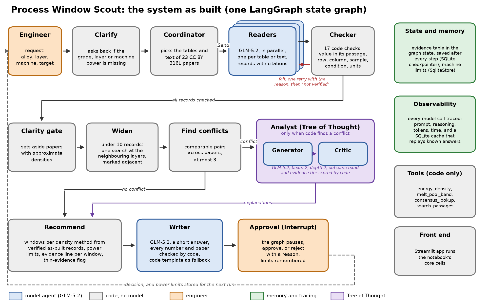

# Process Window Scout (AM-PWS)

A multi-agent research assistant that proposes **laser process windows for metal 3D printing (PBF-LB)** from the
open-access literature, shows the evidence behind every number, and leaves the decision to the engineer.

Project type: Research Assistant.

## Note for CMU:
I kept building the notebook as the course progressed and design evolved and in the end let Claude edit and organise it. Did not create a clean version for the submission and kept the notebook open with all the submission for me to keep track of thinking evolution later also. I hope that is acceptable for code submission. 

## The problem and the user

Before a new alloy or machine goes into production, a process engineer needs a starting window: laser power, scan
speed, hatch spacing and layer thickness that give dense parts. The data is spread over many papers, in tables with
different units, measured with different density methods, and it often disagrees. A chatbot answers with plausible
numbers and no source. Process Window Scout answers with numbers that each trace back to a passage in a paper,
checked by code, and it says plainly when the evidence is thin or when no paper covers the request.

## What happens for one request

*"316L, 30 µm layers, relative density above 99.5 %"*

1. **Clarify (code).** If the alloy grade, layer thickness or machine power is missing, the agent asks before it
   searches. The grade question offers only the grades the library has papers on.
2. **Choose and read (code, then GLM-5.2 in parallel).** The Coordinator picks only the papers labelled with the
   requested grade. If the library has none, the run ends there with a plain answer and no paper is read. One Reader
   per table or text section of the chosen papers (today 23 CC BY papers on 316L) extracts power, speed, hatch, layer,
   spot, density, density method and sample condition, each with the passage it came from.
3. **Check (code).** 17 checks per record: the value is in its cited passage, in the right row and column, one sample
   keeps one parameter set across tables, the condition matches the sample label, units and energy density are
   plausible. A failed record goes back to its Reader once, with the reason, then stays "not verified".
4. **Gate and widen (code).** Papers with approximate densities are set aside. With fewer than 10 records at the
   requested layer, one search at the neighbouring layers adds records marked "adjacent", which never set bounds.
5. **Explain conflicts (GLM-5.2, Tree of Thought).** Only when code finds comparable records from different papers
   that disagree. A generator proposes causes, a critic checks them against quotes from both papers, and code scores
   them into an outcome (Resolved, Competing, Unresolved) with an evidence tier.
6. **Recommend (code).** One window per density method, from verified as-built records only, within the machine's
   power limit. Each window carries an evidence line: papers, records, samples below the target inside the window,
   and for each edge whether a failed sample lies beyond it (measured) or the data simply ends (open). A window with
   fewer than three records or from a single paper is flagged "thin evidence, needs review".
7. **Answer (GLM-5.2, checked by code).** A short written answer. Code checks that every number and paper in it
   comes from the results, otherwise one retry, then a template written by code.
8. **Approve (engineer).** The graph pauses. The engineer approves, or rejects with a reason. Power limits given
   here are remembered for that machine and applied to the next run.

## Architecture



One LangGraph state graph. Grey nodes are plain code, blue nodes call the model, orange nodes are the engineer. The
state (the evidence table and every decision) is saved after each step in a SQLite checkpointer, so a paused run can be
resumed later. Machine limits live in a LangGraph store. Every model call is traced with its prompt, reasoning, tokens
and time, and cached so that runs can be replayed. The rules table at the top of the notebook lists every design
decision with the date it was made.

| Component | Built with |
|---|---|
| Model | GLM-5.2 (open weights) on an OpenAI-compatible endpoint, thinking on, reasoning shown at every step |
| Agent graph | LangGraph `StateGraph`, `Send` for parallel Readers and Tree of Thought branches, `interrupt` and `Command(resume=...)` for the engineer, SQLite checkpointer and store |
| Model calls | LangChain `ChatOpenAI` subclass that keeps GLM's reasoning, structured output with Pydantic, SQLite cache, trace callback |
| Retrieval | Qwen3-Embedding-0.6B, ChromaDB with an alloy filter, MMR |
| Tools | `energy_density`, `melt_pool_band`, `consensus_lookup`, `search_passages` as LangChain tools, also served over MCP with fastmcp |
| Papers | Europe PMC search and full-text XML, CC BY licences only |
| Front end | Streamlit, running the notebook's cells tagged `core` |

## Evaluation

I checked extraction against an answer key of 93 values from 10 papers. Another model (Claude) pre-filled the key
from the papers only, and I checked every row against the paper (the key is in [`eval/`](eval/)). Seven newer
papers were compared with an independent reference written the same way. Notebook 10.9 states the thresholds a
deployment would have to meet:

| Metric | Threshold | Measured |
|---|---|---|
| Extraction precision | at least 0.95 | 0.976 |
| Recall of the answer key | at least 0.85 | 0.871 |
| Planted wrong records caught | 100 % | 5 of 5 |
| False alarms of the source check | at most 2 % | 0 of 134 |
| Window and answer numbers traced to a verified passage | 100 % | 115 of 115 |
| Density agreement with the independent reference (7 new papers) | at least 95 % | 56 of 56 matched rows |

Other comparisons in notebook Part 10:
- **Multi-agent against a single tool-using agent at 30 µm:** 32 of 36 densities right against 17.
- **Tree of Thought against a single thinking call:** they name the same cause in all 5 conflicts.
- **Known answers:** in both cases where the paper itself states the cause, the tree names it.
- **Test with contradictory but valid papers:** both records are kept, and the pair goes to the Analyst instead of one
  being called wrong.
- **Escalation on the 5 demo requests:** these were left incomplete on purpose. 4 asked back before searching, 1
  ended with an orientation-only answer, and 3 had thin evidence on the main window. There is no threshold for this
  yet. It would be watched in a supervised pilot.

## Safety and human oversight

- **Code decides what enters a window.** The model reads and writes, and arithmetic is never left to it.
- **No action on a machine.** No tool can write anything or act on equipment. Every window needs the engineer's
  approval, and a rejection needs a reason.
- **The agent defers to the engineer** when the request is ambiguous, when no verified record at the requested layer
  reaches the target (it then shows the neighbouring layers "for orientation only, not a recommendation"), and when a
  window has thin evidence. It also defers when two density methods disagree on one sample, and when a conflict stays
  Competing or Unresolved.
- **Everything is traceable and replayable.** Every value links to its passage, and every model call is traced.

## Limitations

- **A frozen library.** The 23 papers were found with the agent's search tools and screened in code, then frozen. The
  graph reads this library and does not search the web for each request.
- **Thin coverage.** The library covers 20 to 50 µm layers, with most data at 30 and 50 µm. Some windows are boxes
  around different papers and contain samples that missed the target. The evidence line shows this.
- **Gaps in what is extracted.** Machine, laser and scan strategy are not extracted, so diversity is counted in papers
  and density methods only. Comparing setups before the Analyst is future work.
- **The physics band is weak evidence.** The melt-pool model only adds facts to the Analyst's tree. The outlier rule
  that combines it with consensus is shown in notebook 6.6 but not used in the graph.
- **A hosted model.** GLM-5.2 runs on a hosted endpoint. The committed cache replays known questions only.

## How to review this repository

- **Notebook:** [`notebooks/process_window_scout.ipynb`](notebooks/process_window_scout.ipynb) holds the whole system,
  built and tested Part by Part, with all outputs saved. The file is large, so if GitHub does not display it, open it
  in [nbviewer](https://nbviewer.org/github/chinmayphutela95-spec/process-window-scout/blob/main/notebooks/process_window_scout.ipynb):

  | Part | What it covers |
  |---|---|
  | 0 | Settings, cache and traces |
  | 1 | Tools that keep arithmetic out of the model |
  | 2 | The model |
  | 3 | Retrieval and the paper library |
  | 4 | Single-agent baseline |
  | 5 | Reader |
  | 6 | Checker |
  | 7 | Tree of Thought Analyst |
  | 8 | The multi-agent graph and the evidence per window |
  | 9 | Guardrails, memory and the Writer |
  | 10 | Evaluation and readiness |
  | 11 | End-to-end demo |
  | 12 | The app |

- **Samples:** [`samples/`](samples/) holds every extracted record with its check status, and the trace of the
  end-to-end demo.
- **Evaluation:** [`eval/`](eval/) holds the answer key and the independent reference.

## How to run it

Tested on Windows 11 with Python 3.13. Model = GLM 5.2 (hosted on prem at my organisation)

```bash
git clone https://github.com/chinmayphutela95-spec/process-window-scout.git
cd process-window-scout
python -m venv .venv
.venv/Scripts/python -m pip install -r requirements.txt
```

- **Model endpoint (optional):** copy `.env.example` to `.env` and fill in any OpenAI-compatible endpoint serving
  GLM-5.2. Without it, every model call the notebook makes is replayed from `data/llm_cache.sqlite`.
- **Notebook:** open `notebooks/process_window_scout.ipynb`, choose the Python of `.venv` as the kernel, and run all
  cells. The first run downloads 24 open-access papers from Europe PMC (the 23 on 316L and one paper on another steel
  that tests the alloy filter) and the embedding model (about 1.2 GB) from Hugging Face. It took about 17 minutes on
  my laptop, and later runs take about 3 minutes. A Hugging Face warning about unauthenticated requests is harmless.
- **App:** `.venv/Scripts/python -m streamlit run app/streamlit_app.py`, after the notebook has run once (the app
  needs the downloaded papers and the vector database).
- **App test:** `.venv/Scripts/python tests/test_app.py`, also after one notebook run.

I tested these steps on a fresh clone with no `.env`, no saved data and no downloaded model. The notebook finished
with no errors, and all 650 model calls were replayed from the cache.

