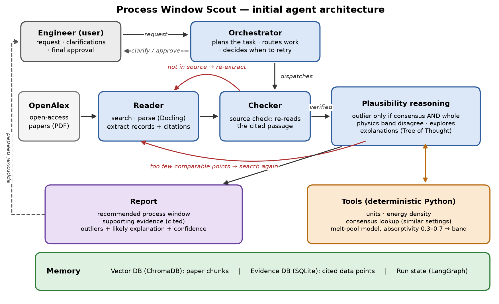

*Text of the submitted version of Checkpoint 1.1, copied from the submitted Word file.*

# Capstone - Project Scoping and Initial Agent Design

**Project:** Process Window Scout (AM-PWS) - an autonomous research agent for metal 3D-printing process parameters

**Project type:** Research Assistant

## 1. The agent, the problem, and the intended user

**User:** a process engineer qualifying an alloy for laser powder bed fusion (PBF-LB), the most common industrial method for 3D-printing metal parts.

**Problem:** Before printing, the engineer must choose a process window: the laser power, scan speed, hatch spacing and layer thickness that produce a dense, defect-free part. The knowledge is spread across many papers, buried in tables, in inconsistent units, and sometimes contradictory. Engineers spend days collecting numbers with no easy way to tell which to trust, or to do time/cost expensive experimental trials.

**Agent:** Process Window Scout would take a request such as "316L stainless steel, 200 W machine, 30 µm layers, target density above 99.5%" and autonomously:

- finds and reads relevant open-access papers;
- builds a cited dataset of reported parameters and resulting densities;
- checks each result for plausibility by combining agreement across papers with a numerical model of the melt pool;
- recommends a process window and explains the outliers, the results that disagree with the other evidence.
## 2. Why a standalone LLM or simple prompting is not enough

- **LLMs are unreliable with numbers.** A chatbot produces plausible settings with no traceable source. Every value here must come from a cited paper, and all arithmetic must be done by deterministic tools.
- **The corpus exceeds a context window** and needs retrieval.
- **The task is multi-step and conditional.** Sparse or conflicting data requires the agent to search again, compare sources or ask the user.
- **Weighing uncertain evidence is a judgment call.** Deciding whether a result is an outlier means balancing several imperfect signals, which cannot be hard-coded.
## 3. The environment

- **Literature:** the OpenAlex API, filtered to open-access papers with reuse-permitting licenses (about 15–20 papers for the MVP). Only public data is used.
- **Documents:** PDFs parsed into text and tables, chunked and stored in a vector database.
- **Evidence database:** a local SQLite table of extracted data points with citations.
- **Tools (deterministic Python):** unit conversion, volumetric energy density, consensus lookup (results from papers at similar settings), and an analytical melt-pool model (Rosenthal/Eagar-Tsai) run across a range of laser absorptivities to give an uncertainty band, not a single prediction.
- **Models:** locally hosted open-weight LLMs, chosen per role by measured comparison on this task.
- **User:** defines the request, resolves ambiguities, approves the result.
## 4. Actions the agent takes

- **Search**, **download**, **parse** and **index** papers; **retrieve** relevant passages.
- **Extract** parameter-density records in a fixed, validated format, each with its citation.
- **Source-check** each record by re-reading the cited passage; **reject** anything untraceable.
- **Compute** energy density, **look up** consensus from similar settings, and **simulate** the physics band.
- **Weigh** the three signals, explore competing explanations for each outlier (Tree of Thought), and **assign a confidence**.
- **Ask the user** when units or conditions are ambiguous.
- **Write** a report: recommended window, supporting evidence, and explained outliers.
## 5. How feedback guides behaviour across steps

The agents run a reasoning loop (reason → act with a tool → observe → adjust):

- **Source feedback:** a value not found in its cited passage is re-extracted once, then discarded and logged.
- **Coverage feedback:** too few comparable data points triggers a wider search.
- **Plausibility feedback:** a result is flagged only when it disagrees with both the consensus and the entire physics band; the agent then investigates likely causes (different layer thickness, powder, measurement method, or a reporting error).
- **Tool and human feedback:** parsing failures trigger a retry or skip, and no recommendation is final until the user approves it.
**Limitation by design:** analytical melt-pool models are approximate, so physics is treated as weak evidence with an uncertainty band, never as ground truth.

**Evaluation:** extraction accuracy on a hand-checked sample, and outlier detection on deliberately corrupted records.

**Ideal Build plan (flexible as l learn):** one agent with tools first, then retrieval, Tree of Thought, Reader/Checker agents and guardrails, following the course modules. Future work: absorptivity calibration from data, more alloys, a GUI.

## Architecture (initial)

Figure 1. Initial agent architecture. Red arrows are feedback loops; dashed arrows are human-in-the-loop steps (*AI Generated Image).
