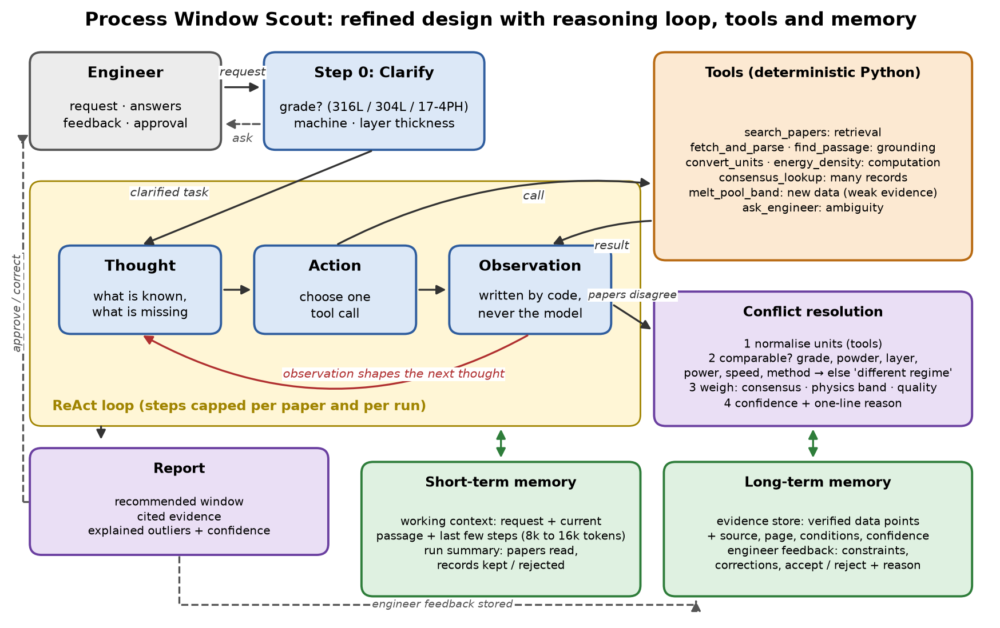

*Text of the version submitted on 2026-10-18, copied from the submitted Word file.*

# Capstone Checkpoint 2.1: Agent Design Refinement

**Project:** Process Window Scout (AM-PWS), a research agent for selecting PBF-LB process parameters

**Project type:** Research Assistant

Here I refine the Checkpoint 1.1 design around the reasoning loop, memory and tools, justifying each by a limitation it removes. I also answer the two questions from the 1.1 feedback: how the agent handles conflicting papers, and how an engineer's feedback carries over to later runs.

## 1. Reasoning loop

The agent uses a ReAct loop. At each step the model would write a short thought about what it has and what is missing, then chooses one tool call. The code runs the tool and adds its output to the context as the observation. Steps are capped per paper and per run, and tool errors come back as observations so the agent can correct itself.

Before searching, the agent checks that the request is specific enough. "Stainless steel" can mean 316L, 304L or 17-4PH, which behave quite differently in PBF-LB. If the grade, machine or layer thickness is missing, it asks the engineer first, because a mistake here carries through every later step.

Typical observations change the next decision as follows:

| **Observation** | **Next decision** |
|---|---|
| Fewer than about 10 data points at the requested layer thickness | Widen to neighbouring thicknesses and mark those points "adjacent" |
| Extracted value not found in the cited passage | Re-extract once, otherwise discard and log |
| Two papers report different outcomes | Run the conflict check below |
| Tool error | Retry once with corrected input, otherwise skip and record |

**Conflicting findings.** Different results only count as a conflict if the experiments are comparable:

- **Normalise.** Tools convert units and compute volumetric energy density.
- **Check comparability.** In my experience the main factors are alloy grade and powder, layer thickness, laser power and scan speed, followed by hatch spacing, spot size, machine, density measurement method and heat treatment. If these differ, the papers describe different process regimes, and both results are kept with a label.
- **Weigh real conflicts.** If conditions match but densities disagree, the agent considers the consensus of other papers at similar settings, the melt-pool physics band (weak evidence only, as analytical models are approximate) and reporting quality.
- **Assign confidence** (high, medium or low) with a one-sentence reason the engineer can check.
Steps 1 and 2 are deterministic code. Steps 3 and 4 are where the model's judgement is needed.

## 2. Memory

The task needs both short-term and long-term memory.

| **Memory** | **Contents** | **When and why** |
|---|---|---|
| Short-term working context | Request, current passage, last few steps | Every step; a local model has roughly 8k to 16k usable tokens |
| Short-term run summary | Papers read, records kept or rejected | Within a run of 15 to 20 papers that cannot fit in context together |
| Long-term evidence store | Verified data points with source, page, conditions and confidence | Across runs; the model is stateless and verified data should not be re-extracted |
| Long-term engineer feedback | Constraints, corrections, accepted or rejected recommendations with reasons | Loaded at the start of every later run |

Feedback affects later runs in three ways. Constraints, such as a 400 W power limit, filter future searches and recommendations. Corrections, for example that a paper measured density on a single polished section, lower the weight of that record in later evaluations. Decisions are stored with their reasons: if a window is rejected for low build rate, build rate becomes a ranking criterion for that engineer.

## 3. Tools

| **Tool** | **Task** | **Limitation addressed** |
|---|---|---|
| search_papers (OpenAlex) | Find open-access papers | Retrieval: model knowledge is fixed and unsourced |
| fetch_and_parse, find_passage | Read papers, locate the passage behind each value | Grounding |
| convert_units, energy_density | Normalise and compute | Computation |
| consensus_lookup | Query stored records at similar settings | Computation over many records |
| melt_pool_band | Melt-pool depth for absorptivity 0.3 to 0.7 | New data where no paper reports results |
| ask_engineer | Resolve an unclear grade or unit | Ambiguity |

Energy density shows why tools are needed. Comparing papers requires E = P / (v·h·t) in consistent units, but one paper may give speed in m/s and hatch spacing in µm, another in mm/s and mm. Converting in text, a language model can be off by a factor of 1000; Module 1 showed that even 9.11 versus 9.9 is unreliable. The tool computes exactly and returns its inputs with the result, for instance "E = 72.2 J/mm³ (P = 195 W, v = 900 mm/s, h = 0.10 mm, t = 0.03 mm)".

## 4. Improvement over a prompt-only approach

Asked "Which laser power and scan speed give above 99.5% density for 316L at 30 µm layers? Please cite sources", a prompt-only model usually would answer fluently, but the answer may cite papers that do not exist or do not support the value, mix units, hide disagreement between studies, and assume a grade.

The failure I target is the fabricated citation. A value only enters the evidence store if find_passage locates it in the cited paper, so an invented reference cannot reach the recommendation. The clarification step, tool calculations and the conflict check cover the other problems. In the final project notebook I plan to run this prompt-only baseline next to the agent, so the difference is measured rather than claimed.

The build plan is unchanged: one ReAct agent with tools first, split into Reader and Checker agents in the multi-agent module.

Figure 1. Refined design. The red arrow is the ReAct feedback; dashed lines are engineer interactions.
