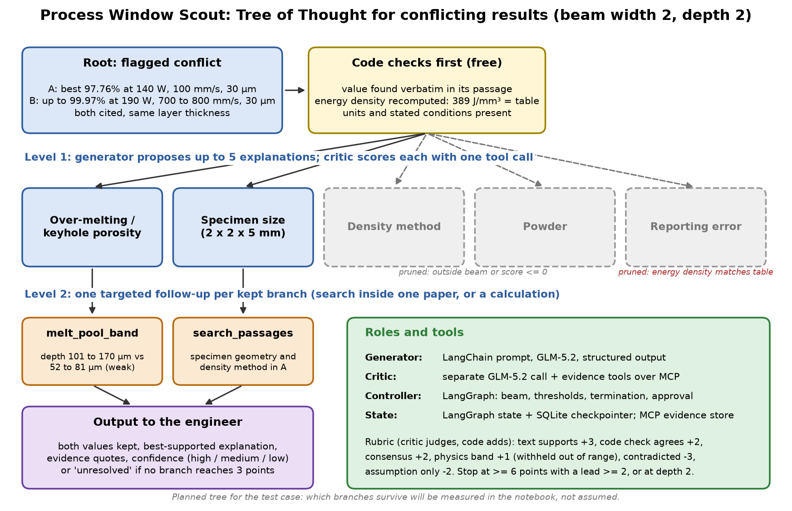

*Text of the version submitted for Checkpoint 4.1, copied from the submitted Word file.*

# Capstone Checkpoint 4.1: Tree-of-Thought Integration Plan

**Project:** Process Window Scout (AM-PWS), a research agent for selecting PBF-LB process parameters

**Project type:** Research Assistant

## 1. Is Tree of Thought appropriate?

I would assume it is partly appropriate. Searching papers, extracting values and checking units are linear steps with one correct result. Likely, branching there would multiply model calls without improving accuracy. One step does benefit: explaining why comparable studies disagree. Several explanations are plausible at once, each needs different evidence, and taking the first one that sounds right is the typical mistake.

## 2.1 Where ToT could be used, and why a linear chain might fail

After extraction, code compares records at comparable conditions (alloy, process, layer thickness, hatch spacing) and flags a conflict when they disagree or a study's best result sits far below the consensus. A case from my retrieval test: one study's best density is 97.76% at 140 W and 100 mm/s, another reaches 99.97% at 190 W and 700 to 800 mm/s, both at 30 µm layers.

A linear chain fails here in three ways. **Premature commitment:** in Checkpoint 3 the model reported 97.76% faithfully but could not judge it. A single chain adopted to the first plausible explanation, such as "measurement error", and build on it. **High branching:** at least five causes are plausible (powder, density measurement method, specimen geometry or machine, keyhole porosity at very high energy density, extraction or reporting error), and each needs a different tool call to check. **Constraint complexity:** a good explanation must agree with the paper text, the recomputed energy density and the physics estimate at the same time.

## 2.2 ToT structure

- **Root:** the conflict case: both records with values, conditions and citations.
- **Thought:** one candidate explanation with the evidence gathered for it.
- **Node:** an explanation at a given stage, with evidence and score; a **branch** is one line of explanation from the root.
- **Depth:** level 1 proposes an explanation and checks it with one tool call; level 2 runs a more specific follow-up for branches still in the beam.
- **Branching factor and depth limit:** up to 5 explanations at level 1, from a fixed list of cause categories; 2 follow-ups per kept branch; maximum depth 2.
- **Termination:** the search stops when one explanation scores at least 6 points and leads the next by at least 2, when depth 2 is reached, or when every branch is pruned. The output keeps both values unchanged and adds the best-supported explanation with its evidence and a confidence level. If nothing is supported, the conflict is reported as unresolved.
## 2.3 Search and evaluation strategy

I will experiment with **beam search with a width of 2**. The explanations are few and known in advance, so they should be compared side by side. Two branches rather than one would likely protect against a single misjudged score.

| **Planned Criterion (judged with a quote or tool result) [to be tested!!]** | **Points** |
|---|---|
| Paper text directly supports the explanation | +3 |
| A deterministic check agrees (recomputed energy density, units, stated conditions) | +2 |
| Consistent with comparable papers (consensus lookup) | +2 |
| Consistent with the melt-pool physics band at all absorptivities | +1 |
| Paper text contradicts the explanation | -3 |
| Rests on assumption only, no evidence found | -2 |

**Who evaluates:** first free deterministic checks (value found verbatim in its passage, energy density recomputed from the stated conditions, units). Then tool calls that gather evidence (passage search in one paper, stated conditions, melt-pool band, consensus lookup). Finally, a critic agent, a separate GLM-5.2 call that would see the evidence but not the generator's reasoning. The critic judges each criterion and then code would add the points.

**Pruning and failure:** a branch is dropped when its score is zero or below after level 1, or when it falls outside the top two. A tool that fails twice marks the branch "not checkable", which is reported rather than silently pruned. If no branch reaches 3 points, the case would be considered unresolved.

**Ties:** the branch with direct quoted evidence would win. Otherwise the critic would compare the two branches pairwise and if they are still tied, both would be repo

**Test case:** for the conflict above, the recomputed energy density, 140 / (100 x 0.12 x 0.03) = 389 J/mm³, matches the study's table and should prune the reporting error branch, while the physics band (melt pool 101 to 170 µm deep, against 52 to 81 µm for the second study) weakly supports over-melting. I will run the same cases with a single thinking call and keep ToT only if it does better.

## 2.4 Risk and mitigation

**Risk: weak evaluation signals pruning the best branch.** A critic can favour fluent, generic explanations such as "measurement error" and penalise a correct one whose evidence is harder to find.

**Mitigation: evidence-gated scoring.** A criterion earns points only when the critic cites a quote or tool result, and code checks that the quote exists in the paper. With a beam of two, one wrong score cannot remove the best explanation alone, and I will calibrate the thresholds on three to five known conflicts first.

Figure 1. Planned Tree of Thought for a flagged conflict, with the roles and tools behind each step. Chart prepared with help of AI.
