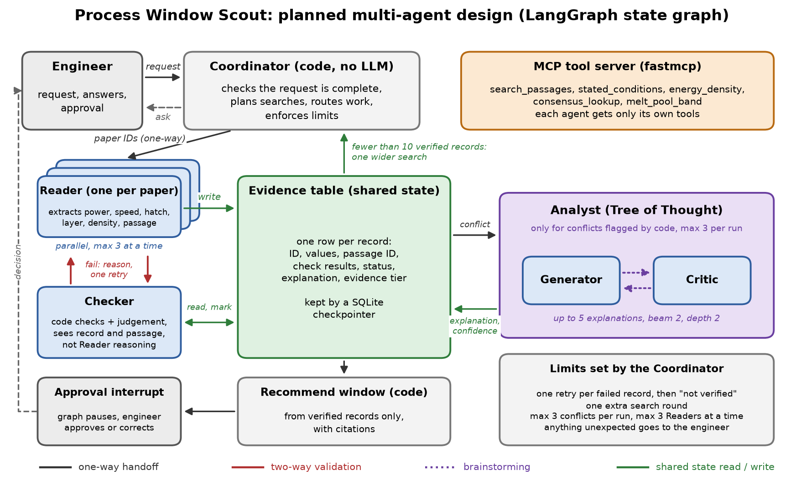

# Capstone Checkpoint 5.1: Multi-Agent Architecture and Coordination Plan

**Project:** Process Window Scout (AM-PWS), a research agent for selecting PBF-LB process parameters
**Project type:** Research Assistant

## 1. Problem and why more than one agent

An engineer choosing a starting process window, say for 316L at 30 µm layers, has to compare papers with different conditions and units that sometimes disagree. Process Window Scout is meant to find open-access papers, extract parameter sets with densities and citations, check them, explain conflicts and recommend a window for the engineer to approve.

A single agent would carry every paper in one growing context and check its own extractions, which mostly means agreeing with itself. Following this module's rule, a role becomes a separate agent only if it needs different tools or knowledge, can run in parallel, or must check another agent's work.

## 2. Agents and roles

| Agent | Planned responsibility | Why separate |
|---|---|---|
| Reader (one per paper) | Will extract power, speed, hatch, layer thickness, density and method, each with its source passage | Own knowledge (one paper), can run in parallel |
| Checker | Will run code checks (value verbatim in its passage, energy density recomputed, required conditions present, same process), then judge primary versus quoted data | Independent check, without access to the Reader's reasoning |
| Analyst | Will explain flagged conflicts with Tree of Thought and assign an evidence tier and confidence | Own reasoning style and tools (physics band, consensus) |

The supervisor will be a Coordinator in plain code that checks the request names the alloy grade and layer thickness, plans searches, routes work and enforces limits. A Planner, Searcher, Physics agent and Writer were considered but fail the rule: planning is a few fields, search and physics are single tool calls, and code can compute the window. Three is the smallest set in which no agent checks its own work. Each extra agent would add calls and another hop where errors compound, since five steps at 95% reliability succeed only 77% of the time.

## 3. Coordination

The planned flow is hybrid: a sequential backbone (read, check, resolve, recommend) built as a LangGraph state graph, branching only where needed.

- **Parallel:** one Reader per paper, at most three at a time.
- **Bounded loop:** a failed record will go back to its Reader once, with the reason. A second failure marks it "not verified" and keeps it out of the window.
- **Conditional:** the Analyst will run only on conflicts flagged by code, at most three per run.
- **Human gate:** the graph will pause for the engineer's approval, with a checkpointer saving the state.

## 4. Communication

The agents will not call each other but will share an evidence table in the graph state. Each record will hold an ID, values, a passage ID, check results and a status, and each agent may write only its own fields. The type of communication will follow the stakes:

- **One-way**, Coordinator to Reader: cheap, with nothing to validate yet.
- **Two-way**, Checker and Reader: a wrong number would reach the recommendation, so the Checker will return a structured reason, for example "99.7% not found in passage, nearest value 97.7%".
- **Brainstorming** only inside the Analyst, where there is no source of truth yet and several explanations compete.

## 5. Trade-offs and scaling

| Choice | Expected gain | Cost and limit |
|---|---|---|
| Checker loop | Catches wrong or invented values | Extra calls, limited to one retry |
| Tree of Thought | Weighs several explanations | About 11 calls per conflict, capped per run |
| Coordinator in code | Predictable, testable, no model cost | Unforeseen cases go to the engineer |
| GLM-5.2 for all agents | Simple setup | Shared blind spots, so the Checker will rely mainly on code |

Adding papers should only mean more Readers, not a new graph. To test whether the coordination pays for itself, I plan to compare it with a single agent on the same papers: accuracy per field, planted errors caught, model calls and run time.

*Figure 1. Planned design: three agents share an evidence table in a LangGraph state graph, and a Coordinator written in code routes the work and enforces the limits. Structure designed with AI*
